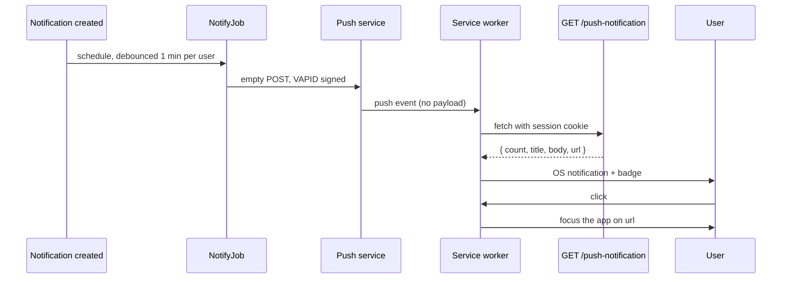

# mermaid

One diagram per concern, built from the code, verified to render, handed over as a fenced `mermaid` block the user can paste into a PR body, a work package description or a markdown file (GitHub and OpenProject both render the fence).

## Pick the shape

- **Sequence diagram** for anything that happens over time: request handling, a background job, an event reaching the browser, a retry loop. Default choice.
- **Flowchart** (`flowchart LR` or `TB`) for a component map: which parts exist and which arrows connect them. Use `subgraph` for process boundaries (browser, Rails, external service).
- **State diagram** only when the subject really is a state machine with named transitions.

If the user asked for "the architecture", offer the component map and one sequence diagram for the main flow, not one giant picture.

## Build it from the code, not from memory

1. Read the files on the path before drawing. Participants are named after what the reader will grep for: the class (`NotifyJob`), the route (`GET /push-notification`), the browser API (`Service worker`), the vendor (`Push service`). No invented names.
2. Keep each message to the fact that matters for the reader: what is sent and what comes back, not every header. Byte-level or RFC detail goes into a `Note over` only when it changes the reader's mental model (for example "payload is empty").
3. Mark branches with `alt`/`else` and retries with `loop`; cap at two levels of nesting. Beyond that, split the diagram.
4. Six to eight participants is the ceiling. More means the concern is too wide; split by phase (subscribe, deliver, click).
5. No em dashes in labels. Keep labels short; a label longer than about 40 characters belongs in a note or in the prose under the diagram.

## Validate that it renders

Mermaid fails silently in chat, so render before handing over.

1. Write the source to `<scratchpad>/<slug>.mmd`.
2. If `mmdc` is on PATH, run:

   ```bash
   mmdc -i <scratchpad>/<slug>.mmd -o tmp/ai/screenshots/<slug>.png -b white
   ```

   Then read the PNG and check it against the intent (participants in the expected order, every arrow present, no `Syntax error` box in the image).
3. If `mmdc` is missing, say so once and offer `npm install -g @mermaid-js/mermaid-cli` (downloads a headless Chromium once). Do not run `npx` against it unasked. Without a renderer, re-read the source against the pitfalls below and state plainly that it is unverified.

Common failures: a participant used before it is declared when `autonumber` or aliases are on; `:` inside a message label without quoting; `end` as a participant name; `-->>` vs `->>` mixed up (dashed is the reply); subgraph ids containing spaces without quotes.

## Hand over

- Put the fenced block in the reply, nothing else inside the fence.
- One or two sentences under it saying what the diagram leaves out (for example error paths, or the admin side).
- If the user asked to copy it, also open the markdown via the `nvim-draft` skill.
- Never write the diagram into a PR description or work package yourself; the user owns those texts. Save it under `<scratchpad>/<slug>.md` and give the path.

## Example of the house style


